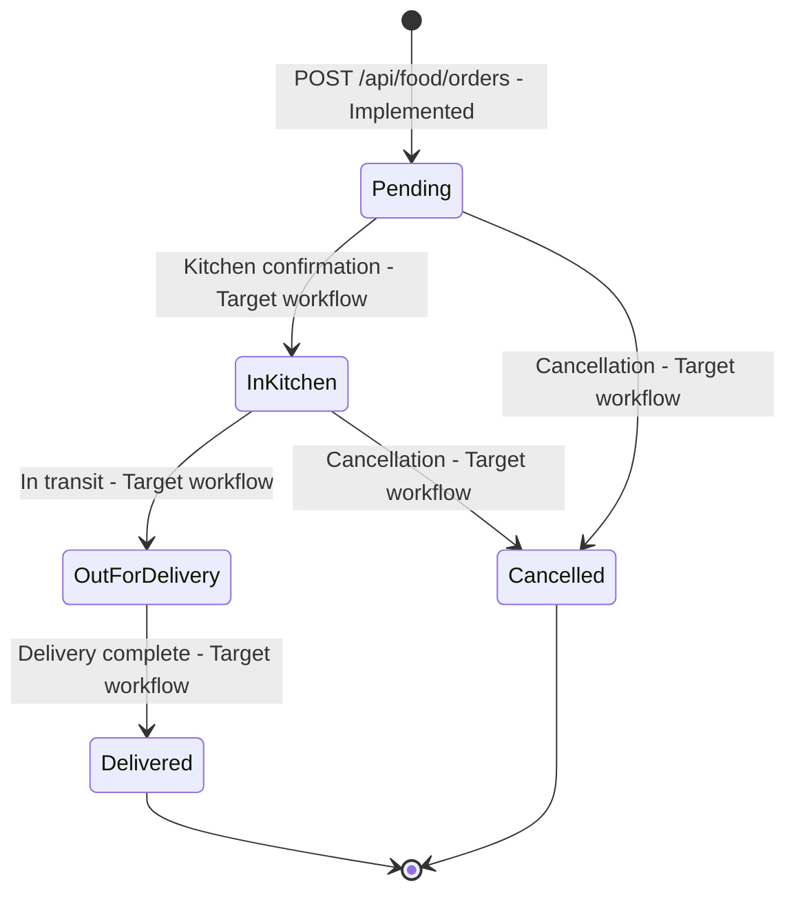

# TENZAL Luxury Resort — Food Ordering API Documentation

**Module:** Food Ordering (In-Room Dining Subsystem)  
**Student ID:** `22CIS0328`  
**Target Database:** PostgreSQL 17 (Supabase / Local)  
**API Runtime:** Node.js / Express  
**Specification Version:** 1.1.0  

> [!NOTE]
> **Illustrative Examples Notice:** All JSON request and response payloads, order codes, database IDs, preparation times, prices, and timestamps shown throughout this documentation are illustrative examples provided for integration guidance. They represent the API data schema and contract, not guaranteed live database records.

---

## 1. Overview & Architecture

The Food Ordering API powers the in-room dining services for TENZAL Luxury Resort. It provides endpoints for retrieving food categories, menu dishes, daily chef specials, and placing atomic in-room dining orders with room whitelist validation, server-side monetary calculations, and initial audit logging.

### Architecture Highlights
- **Zero-Trust Financial Logic:** Prices, subtotals, resort service charges, and grand totals are calculated authoritatively on the server using integer-cents arithmetic (`Math.round(price * 100)`). Client-supplied prices and totals are strictly ignored.
- **ACID Transaction Atomicity:** Order placement writes atomically across `orders`, `order_details`, and `order_status_history` within a PostgreSQL transaction block (`BEGIN` / `COMMIT` / `ROLLBACK`).
- **Resilient Code Generation:** Unique human-friendly order codes (`ORD-YYYYMMDD-XXXXXX`) are generated using 3-byte cryptographic randomness with an automatic 3-attempt collision retry handler.
- **Room Whitelist Validation:** Order destinations are validated against an approved whitelist of resort room identifiers (`Room 3`, `Room 4`, and `Room 5`) with canonical display name matching. *(Note: This validates room destination naming format only; guest identity or room occupancy is not verified by this module).*

### Base URLs
- **Local Development (Express Default):** `http://localhost:5000/api/food`
- **Android Emulator Loopback:** `http://10.0.2.2:5000/api/food`
- **Health Check Base:** `http://localhost:5000/api`

---

## 2. Server Health Check Endpoints

### 2.1 API Health Check
Returns the current operational status of the Express application server.

- **Method:** `GET`
- **Path:** `/api/health`
- **Authentication:** None

#### Response (Illustrative — `200 OK`)
```json
{
  "status": "ok",
  "service": "TENZAL Luxury Resort - Food Ordering API",
  "module": "Food Ordering (22CIS0328)",
  "timestamp": "2026-11-08T11:30:00.000Z"
}
```

---

### 2.2 Database Connectivity Health Check
Executes a heartbeat query (`SELECT 1 AS connected, NOW() AS db_time;`) against PostgreSQL via connection pool.

- **Method:** `GET`
- **Path:** `/api/db-health`
- **Authentication:** None

#### Response (Illustrative — `200 OK`)
```json
{
  "status": "ok",
  "database": "connected",
  "driver": "PostgreSQL (pg)",
  "db_time": "2026-11-08T11:30:00.000Z",
  "timestamp": "2026-11-08T11:30:00.000Z"
}
```

#### Failure Response (Illustrative — `503 Service Unavailable`)
```json
{
  "status": "error",
  "database": "disconnected",
  "message": "Database health check failed",
  "timestamp": "2026-11-08T11:30:00.000Z"
}
```

---

## 3. Food Ordering Endpoints

### 3.1 Get Food Categories
Retrieves the culinary categories used for grouping resort offerings.

- **Method:** `GET`
- **Path:** `/api/food/categories`
- **Controller:** `getCategories`

#### Query Parameters
| Parameter | Type | Required | Default | Description |
| :--- | :--- | :---: | :---: | :--- |
| `all` | `string` | No | `false` | When set to `'true'`, includes inactive categories (`is_active = FALSE`). Otherwise, only active categories are returned. |

#### Response (Illustrative — `200 OK`)
```json
{
  "status": "success",
  "success": true,
  "count": 5,
  "data": [
    {
      "category_id": 1,
      "name": "Breakfast",
      "slug": "breakfast",
      "description": "Artisan morning culinary experiences and light bites",
      "display_order": 1,
      "is_active": true,
      "created_at": "2026-11-08T00:00:00.000Z",
      "updated_at": "2026-11-08T00:00:00.000Z"
    },
    {
      "category_id": 2,
      "name": "Lunch",
      "slug": "lunch",
      "description": "Midday coastal delicacies, artisanal burgers, and wood-fired flatbreads",
      "display_order": 2,
      "is_active": true,
      "created_at": "2026-11-08T00:00:00.000Z",
      "updated_at": "2026-11-08T00:00:00.000Z"
    },
    {
      "category_id": 3,
      "name": "Dinner",
      "slug": "dinner",
      "description": "Elevated evening fine dining and reserve cuts",
      "display_order": 3,
      "is_active": true,
      "created_at": "2026-11-08T00:00:00.000Z",
      "updated_at": "2026-11-08T00:00:00.000Z"
    },
    {
      "category_id": 4,
      "name": "Drinks",
      "slug": "drinks",
      "description": "Botanical tonics, cold brews, and tropical elixirs",
      "display_order": 4,
      "is_active": true,
      "created_at": "2026-11-08T00:00:00.000Z",
      "updated_at": "2026-11-08T00:00:00.000Z"
    },
    {
      "category_id": 5,
      "name": "Desserts",
      "slug": "desserts",
      "description": "Highland confections, tropical gelatos, and warm pastries",
      "display_order": 5,
      "is_active": true,
      "created_at": "2026-11-08T00:00:00.000Z",
      "updated_at": "2026-11-08T00:00:00.000Z"
    }
  ]
}
```

---

### 3.2 Get Active Daily Specials
Retrieves chef-curated daily specials that are currently active and available.

- **Method:** `GET`
- **Path:** `/api/food/specials`
- **Controller:** `getDailySpecials`

#### Business Rules
- Returns only dishes where `is_special = TRUE`, `is_available = TRUE`, and joined category `is_active = TRUE`.
- Respects scheduling windows: `(special_start_at IS NULL OR special_start_at <= CURRENT_TIMESTAMP) AND (special_end_at IS NULL OR special_end_at >= CURRENT_TIMESTAMP)`.

#### Query Parameters
| Parameter | Type | Required | Description |
| :--- | :--- | :---: | :--- |
| `category_id` | `integer` | No | Filters daily specials by category ID (must be a positive integer). |
| `category_slug` | `string` | No | Filters daily specials by category slug (case-insensitive). |

#### Response (Illustrative — `200 OK`)
```json
{
  "status": "success",
  "success": true,
  "count": 1,
  "data": [
    {
      "item_id": 15,
      "category_id": 3,
      "name": "Ceylon Spiced Rock Lobster",
      "subtitle": "Wild garlic butter & lemongrass emulsion",
      "description": "Fresh southern ocean rock lobster poached in wild garlic butter with lemongrass essence, served with organic baby greens.",
      "price": 16500.00,
      "prep_time_minutes": 25,
      "image_url": "https://images.unsplash.com/photo-1533777857889-4be7c70b33f7?q=80&w=800&auto=format&fit=crop",
      "is_available": true,
      "is_special": true,
      "special_badge": "Chef's Signature",
      "special_start_at": "2026-11-01T00:00:00.000Z",
      "special_end_at": "2026-11-30T23:59:59.000Z",
      "ingredients": [
        "Southern Coast Rock Lobster",
        "Wild Highland Garlic",
        "Lemongrass Infused Butter",
        "Organic Baby Greens"
      ],
      "created_at": "2026-11-08T00:00:00.000Z",
      "updated_at": "2026-11-08T00:00:00.000Z",
      "category_name": "Dinner",
      "category_slug": "dinner",
      "category": {
        "category_id": 3,
        "name": "Dinner",
        "slug": "dinner",
        "description": "Elevated evening fine dining and reserve cuts",
        "display_order": 3,
        "is_active": true
      }
    }
  ]
}
```

---

### 3.3 Get Food Items
Retrieves culinary dishes with optional category filtering, availability filtering, and keyword search.

- **Method:** `GET`
- **Path:** `/api/food/items`
- **Controller:** `getFoodItems`

#### Query Parameters
| Parameter | Type | Required | Default | Description |
| :--- | :--- | :---: | :---: | :--- |
| `category_id` | `integer` | No | — | Filter by positive integer category ID. |
| `category_slug` | `string` | No | — | Filter by category slug (e.g. `'breakfast'`, `'lunch'`, `'dinner'`, `'drinks'`). |
| `available` | `string` | No | `'true'` | Availability filter. Allowed values: `'true'` (in stock only), `'false'` (sold out only), or `'all'` (all items). |
| `search` / `q` | `string` | No | — | Case-insensitive substring search matching against `name`, `subtitle`, or `description`. |

#### Response (Illustrative — `200 OK`)
```json
{
  "status": "success",
  "success": true,
  "count": 2,
  "data": [
    {
      "item_id": 1,
      "category_id": 1,
      "name": "Tenzal Tropical Acai Bowl",
      "subtitle": "Organic berries, toasted coconut & honey",
      "description": "Organic acai puree blended with highland strawberries, topped with chia seeds, toasted coconut flakes, and raw Haputale honey.",
      "price": 4200.00,
      "prep_time_minutes": 12,
      "image_url": "https://images.unsplash.com/photo-1590301157890-4810ed352733?q=80&w=600&auto=format&fit=crop",
      "is_available": true,
      "is_special": false,
      "special_badge": null,
      "special_start_at": null,
      "special_end_at": null,
      "ingredients": [
        "Organic Acai Puree",
        "Highland Strawberries",
        "Chia Seeds",
        "Wild Forest Honey"
      ],
      "created_at": "2026-11-08T00:00:00.000Z",
      "updated_at": "2026-11-08T00:00:00.000Z",
      "category_name": "Breakfast",
      "category_slug": "breakfast",
      "category": {
        "category_id": 1,
        "name": "Breakfast",
        "slug": "breakfast",
        "description": "Artisan morning culinary experiences and light bites",
        "display_order": 1,
        "is_active": true
      }
    },
    {
      "item_id": 4,
      "category_id": 1,
      "name": "Avocado Tartine Crisp",
      "subtitle": "Artisan sourdough, poached egg & dukkah",
      "description": "Toasted country sourdough with smashed Hass avocado, organic poached egg, and roasted seed dukkah.",
      "price": 4500.00,
      "prep_time_minutes": 10,
      "image_url": "https://images.unsplash.com/photo-1525351484163-7529414344d8?q=80&w=600&auto=format&fit=crop",
      "is_available": false,
      "is_special": false,
      "special_badge": null,
      "special_start_at": null,
      "special_end_at": null,
      "ingredients": [
        "Hass Avocado",
        "Country Sourdough",
        "Roasted Seeds",
        "Chili Flakes"
      ],
      "created_at": "2026-11-08T00:00:00.000Z",
      "updated_at": "2026-11-08T00:00:00.000Z",
      "category_name": "Breakfast",
      "category_slug": "breakfast",
      "category": {
        "category_id": 1,
        "name": "Breakfast",
        "slug": "breakfast",
        "description": "Artisan morning culinary experiences and light bites",
        "display_order": 1,
        "is_active": true
      }
    }
  ]
}
```

---

### 3.4 Get Single Food Item by ID
Retrieves full details for a specific dish by primary key.

- **Method:** `GET`
- **Path:** `/api/food/items/:id`
- **Controller:** `getFoodItemById`

#### Path Parameters
| Parameter | Type | Required | Description |
| :--- | :--- | :---: | :--- |
| `id` | `integer` | Yes | Positive integer ID corresponding to `item_id`. |

#### Response (Illustrative — `200 OK`)
```json
{
  "status": "success",
  "success": true,
  "data": {
    "item_id": 1,
    "category_id": 1,
    "name": "Tenzal Tropical Acai Bowl",
    "subtitle": "Organic berries, toasted coconut & honey",
    "description": "Organic acai puree blended with highland strawberries, topped with chia seeds, toasted coconut flakes, and raw Haputale honey.",
    "price": 4200.00,
    "prep_time_minutes": 12,
    "image_url": "https://images.unsplash.com/photo-1590301157890-4810ed352733?q=80&w=600&auto=format&fit=crop",
    "is_available": true,
    "is_special": false,
    "special_badge": null,
    "special_start_at": null,
    "special_end_at": null,
    "ingredients": [
      "Organic Acai Puree",
      "Highland Strawberries",
      "Chia Seeds",
      "Wild Forest Honey"
    ],
    "created_at": "2026-11-08T00:00:00.000Z",
    "updated_at": "2026-11-08T00:00:00.000Z",
    "category_name": "Breakfast",
    "category_slug": "breakfast",
    "category": {
      "category_id": 1,
      "name": "Breakfast",
      "slug": "breakfast",
      "description": "Artisan morning culinary experiences and light bites",
      "display_order": 1,
      "is_active": true
    }
  }
}
```

#### Error Responses (Illustrative)
- `400 Bad Request`: When `:id` is not a positive integer:
  ```json
  {
    "status": "error",
    "success": false,
    "message": "Invalid food item ID. ID must be a positive integer."
  }
  ```
- `404 Not Found`: When the dish does not exist:
  ```json
  {
    "status": "error",
    "success": false,
    "message": "Food item with ID 999 not found."
  }
  ```

---

### 3.5 Create In-Room Dining Order
Places an in-room dining order atomically within a PostgreSQL transaction.

- **Method:** `POST`
- **Path:** `/api/food/orders`
- **Controller:** `createOrder`
- **Content-Type:** `application/json`

#### Request Body Schema
| Field | Type | Required | Constraints | Description |
| :--- | :--- | :---: | :--- | :--- |
| `room_number` | `string` | **Yes** | Whitelist: `'Room 3'`, `'Room 4'`, `'Room 5'` | Assigned resort room string for delivery destination. |
| `room_name` | `string` | **Yes** | Must match canonical name for `room_number` | Approved canonical display name corresponding to `room_number`. |
| `special_note` | `string` | No | Max 500 characters | Optional dietary restrictions or kitchen instructions. |
| `customer_id` | `string` | No | Max 64 characters | Optional customer/guest identifier placeholder. |
| `items` | `array` | **Yes** | Non-empty array, max 50 units per dish | List of dish items and requested quantities. |
| `items[].item_id` | `integer` | **Yes** | Positive integer | Target dish ID. (`id` also accepted). |
| `items[].quantity` | `integer` | **Yes** | Integer between 1 and 50 | Units ordered. (`qty` also accepted). |

> [!NOTE]
> **Client Pricing Zero-Trust:** Do NOT send `price`, `subtotal`, `service_charge`, or `total_amount` in the request body. Any client-sent prices are discarded; the server authoritatively fetches prices from PostgreSQL.

#### Approved Delivery Room Whitelist
```javascript
{
  "Room 3": "Uva Valley View Room — Room 3",
  "Room 4": "Bridal Suite, Uva Valley — Room 4",
  "Room 5": "Indian Ocean View Room — Room 5"
}
```
*(Lenient dash matching is supported: `—`, `–`, and `-` are treated as equivalent).*

#### Example Request (Current Mobile Client Flow — Illustrative)
```json
{
  "room_number": "Room 3",
  "room_name": "Uva Valley View Room — Room 3",
  "special_note": "Please deliver with extra warm butter and cutlery",
  "items": [
    { "item_id": 1, "quantity": 2 },
    { "item_id": 2, "quantity": 1 }
  ]
}
```
*(Note: The current mobile client does not send `customer_id`; `customer_id` is an optional schema placeholder for future User Management integration).*

#### Example Response (Current Mobile Client Flow — Illustrative — `201 Created`)
```json
{
  "status": "success",
  "success": true,
  "message": "In-room dining order placed successfully.",
  "data": {
    "order_id": 12,
    "order_code": "ORD-20261108-7F3A2B",
    "room_number": "Room 3",
    "room_name": "Uva Valley View Room — Room 3",
    "customer_id": null,
    "special_note": "Please deliver with extra warm butter and cutlery",
    "subtotal": 13200.00,
    "service_charge": 1320.00,
    "total_amount": 14520.00,
    "status": "Pending",
    "estimated_delivery_minutes": 30,
    "created_at": "2026-11-08T11:45:00.000Z",
    "updated_at": "2026-11-08T11:45:00.000Z",
    "items": [
      {
        "order_detail_id": 25,
        "order_id": 12,
        "item_id": 1,
        "item_name": "Tenzal Tropical Acai Bowl",
        "unit_price": 4200.00,
        "quantity": 2,
        "line_total": 8400.00,
        "created_at": "2026-11-08T11:45:00.000Z"
      },
      {
        "order_detail_id": 26,
        "order_id": 12,
        "item_id": 2,
        "item_name": "Brioche French Toast",
        "unit_price": 4800.00,
        "quantity": 1,
        "line_total": 4800.00,
        "created_at": "2026-11-08T11:45:00.000Z"
      }
    ],
    "status_history": [
      {
        "history_id": 40,
        "order_id": 12,
        "previous_status": null,
        "new_status": "Pending",
        "changed_by_user_id": null,
        "change_reason": "Order placed by guest via in-room dining mobile app",
        "created_at": "2026-11-08T11:45:00.000Z"
      }
    ]
  }
}
```
*(Note on `customer_id` and `changed_by_user_id`: The current mobile client does not send `customer_id`, so these fields evaluate to `null` in the current mobile client flow shown above. If an optional `customer_id` string is supplied in the request body (e.g. in future integration scenarios), the backend stores that string in `orders.customer_id` and records it in `order_status_history.changed_by_user_id`).*

#### Order Validation & Error Responses (`400 Bad Request`)
| Validation Scenario | Returned Message |
| :--- | :--- |
| Missing or non-string room | `"room_number is required and must be a valid room string."` |
| Room not in whitelist | `"Invalid room_number. In-room dining delivery is available exclusively to Room 3, Room 4, and Room 5."` |
| Room name mismatch | `"Invalid room_name. Room name does not match the approved room name for Room 3 (Expected: \"Uva Valley View Room — Room 3\")."` |
| `special_note` exceeds 500 chars | `"special_note exceeds maximum allowed length of 500 characters."` |
| `customer_id` exceeds 64 chars | `"customer_id exceeds maximum allowed length of 64 characters."` |
| Empty or invalid `items` array | `"Cart must contain at least one item."` |
| Invalid item ID | `"Invalid item_id at index 0. Item ID must be a positive integer."` |
| Quantity < 1 or > 50 | `"Invalid quantity for item 1. Quantity must be an integer between 1 and 50."` |
| Consolidated duplicate units > 50 | `"Combined quantity for item 1 (55) exceeds maximum allowed quantity of 50."` |
| Inactive dish or category | `"Food item with ID 99 does not exist or is currently inactive."` |
| Sold-out dish (`is_available = FALSE`)| `"Food item \"Avocado Tartine Crisp\" is currently sold out and cannot be ordered."` |
| Daily special not yet active | `"Daily special \"Ceylon Spiced Rock Lobster\" is not yet active."` |
| Daily special window expired | `"Daily special \"Ceylon Spiced Rock Lobster\" is no longer active (special window ended)."` |

---

### 3.6 Get Order by ID
Retrieves order details, immutable line-item price snapshots, and lifecycle audit history.

- **Method:** `GET`
- **Path:** `/api/food/orders/:id`
- **Controller:** `getOrderById`

#### Path Parameters
| Parameter | Type | Required | Description |
| :--- | :--- | :---: | :--- |
| `id` | `integer` | Yes | Positive integer matching `order_id`. |

#### Response (Current Mobile Client Flow — Illustrative — `200 OK`)
```json
{
  "status": "success",
  "success": true,
  "data": {
    "order_id": 12,
    "order_code": "ORD-20261108-7F3A2B",
    "room_number": "Room 3",
    "room_name": "Uva Valley View Room — Room 3",
    "customer_id": null,
    "special_note": "Please deliver with extra warm butter and cutlery",
    "subtotal": 13200.00,
    "service_charge": 1320.00,
    "total_amount": 14520.00,
    "status": "Pending",
    "estimated_delivery_minutes": 30,
    "created_at": "2026-11-08T11:45:00.000Z",
    "updated_at": "2026-11-08T11:45:00.000Z",
    "items": [
      {
        "order_detail_id": 25,
        "order_id": 12,
        "item_id": 1,
        "item_name": "Tenzal Tropical Acai Bowl",
        "unit_price": 4200.00,
        "quantity": 2,
        "line_total": 8400.00,
        "created_at": "2026-11-08T11:45:00.000Z"
      }
    ],
    "status_history": [
      {
        "history_id": 40,
        "order_id": 12,
        "previous_status": null,
        "new_status": "Pending",
        "changed_by_user_id": null,
        "change_reason": "Order placed by guest via in-room dining mobile app",
        "created_at": "2026-11-08T11:45:00.000Z"
      }
    ]
  }
}
```
*(Note: As in the order creation flow, `customer_id` and `changed_by_user_id` evaluate to `null` for orders placed via the current mobile client. Non-null values represent an optional scenario where `customer_id` was explicitly supplied).*

#### Error Responses (Illustrative)
- `400 Bad Request`: `"Invalid order ID. Must be a positive integer."`
- `404 Not Found`: `"Order with ID 999 not found."`

---

## 4. Financial Calculations & Monetary Precision

To prevent IEEE 754 floating-point rounding inaccuracies, all calculations use integer-cents arithmetic:

```javascript
// Step 1: Convert unit prices to integer cents
const unitPriceCents = Math.round(priceNum * 100);
const lineTotalCents = unitPriceCents * quantity;

// Step 2: Sum subtotal in cents
subtotalCents += lineTotalCents;

// Step 3: Compute 10% resort service charge rounded to nearest cent
const serviceChargeCents = Math.round(subtotalCents * 0.10);

// Step 4: Compute grand total in cents
const grandTotalCents = subtotalCents + serviceChargeCents;

// Step 5: Format to 2 decimal places for PostgreSQL NUMERIC(10, 2)
const subtotal = (subtotalCents / 100).toFixed(2);
const serviceCharge = (serviceChargeCents / 100).toFixed(2);
const totalAmount = (grandTotalCents / 100).toFixed(2);
```

### Estimated Delivery Turnaround Calculation
Calculated dynamically based on dish kitchen preparation requirements plus transit:
```javascript
const maxPrepTime = prepTimes.length > 0 ? Math.max(...prepTimes) : 20;
const estimatedDeliveryMinutes = Math.max(30, maxPrepTime + 10);
```

---

## 5. Order Status Lifecycle

> [!NOTE]
> **Implementation Scope Notice:** The database check constraint `chk_orders_status_valid` allows five distinct status strings (`Pending`, `In Kitchen`, `Out for Delivery`, `Delivered`, `Cancelled`). However, within the current codebase, **only initial order placement into `Pending` is implemented**. Subsequent status transitions, automated cancellation handlers, and external folio adjustments are illustrative target workflows outlined below for future release phases.

### Database-Allowed Status Values vs. Implementation State

The PostgreSQL table constraint `chk_orders_status_valid` defines the following 5 status strings:

1. `Pending` — **(Implemented in Source)**  
   Initial status automatically assigned upon order placement via `POST /api/food/orders`. An initial audit log entry is written to `order_status_history` (`previous_status: NULL`, `new_status: 'Pending'`).
2. `In Kitchen` — *(Illustrative Target Workflow)*  
   Intended to indicate culinary staff confirmation and preparation start. No transition endpoint is currently implemented.
3. `Out for Delivery` — *(Illustrative Target Workflow)*  
   Intended to indicate that food is plated and in transit with room service staff. No transition endpoint is currently implemented.
4. `Delivered` — *(Illustrative Target Workflow)*  
   Intended to represent delivery completion. No transition endpoint, guest signature handling, or automated room folio billing integration is currently implemented.
5. `Cancelled` — *(Illustrative Target Workflow)*  
   Intended to represent voided or cancelled orders. No guest or supervisor cancellation endpoint is currently implemented.



Currently, only the initial `Pending` audit entry is recorded during order creation (`previous_status: NULL`, `new_status: 'Pending'`). Recording audit entries for subsequent transitions (`In Kitchen`, `Out for Delivery`, `Delivered`, `Cancelled`) depends on implementing dedicated status-transition functionality in future development.

---

## 6. Database Transactions & Concurrency

### Transaction Flow (`OrderModel.create`)
1. Client connection acquired from pool: `const client = await db.pool.connect();`.
2. Transaction begins: `await client.query('BEGIN');`.
3. Master row inserted into `orders`.
4. Line items inserted into `order_details` (snapshots historical item name and unit price).
5. Initial lifecycle entry inserted into `order_status_history`.
6. Transaction committed: `await client.query('COMMIT');`.
7. Client released back to pool in `finally { client.release(); }`.

### Automatic Order Code Collision Retry
In high-concurrency order bursts, if an order code collides with an existing code (`error.code === '23505'` on `orders_order_code_key`):
- Transaction issues `ROLLBACK`.
- Connection is cleanly released.
- A fresh 3-byte code is generated (`ORD-YYYYMMDD-XXXXXX`).
- Up to **3 automatic attempts** are executed before raising an error.

---

## 7. Local Development & Setup

### Environment Variables (`backend/.env`)
```bash
PORT=5000
NODE_ENV=development

# PostgreSQL Connection (Supabase or Local)
DATABASE_URL=postgresql://postgres:[PASSWORD]@[HOST]:5432/[DB_NAME]

# Or discrete parameters
DB_HOST=localhost
DB_PORT=5432
DB_NAME=tenzal_resort
DB_USER=postgres
DB_PASSWORD=[PASSWORD]
DB_SSL=false
```

### Running the Backend
```bash
# Install dependencies
cd backend
npm install

# Start Express server
npm run dev
# Server starts on port 5000: http://localhost:5000
```

---

## 8. Production-Readiness & Security Limitations

The following architectural and security limitations exist in the current implementation and should be addressed prior to multi-tenant production deployment:

### 8.1 Missing Guest Authentication & Session Verification
- **Current Behavior:** Endpoints are publicly accessible without authentication headers or JWT bearer tokens. Order placement accepts any guest-provided `room_number` matching the whitelist.
- **Production Requirement:** Integrate authentication middleware (e.g., verifying guest JWT or session token) linked with the User Management and Room Booking modules to ensure the caller is an active, checked-in occupant of the target room.

### 8.2 Missing Authorization on Order Retrieval (`GET /api/food/orders/:id`)
- **Current Behavior:** Order details and lifecycle history can be retrieved by any caller who supplies an integer `order_id` in the URL path. No check is performed to confirm that the requester owns the order or occupies the associated room.
- **Production Requirement:** Implement ownership authorization middleware restricting order lookups to the authenticated guest who placed the order or staff users with administrative/kitchen roles.

### 8.3 Unverified Room Folio Billing
- **Current Behavior:** The API computes financial totals (subtotal, service charge, grand total) and records them against the specified room string. No connection to an external Property Management System (PMS) or room deposit pre-authorization exists.
- **Production Requirement:** Integrate with the central resort billing service to verify room credit status before confirming orders.

### 8.4 Delivery Scope Limited to Whitelist
- In-room dining delivery is currently limited to approved rooms `Room 3`, `Room 4`, and `Room 5`. Expansion to additional resort suites, villas, and outdoor pavilions requires updating the room whitelist configuration.

### 8.5 Absence of Order Lifecycle Transition Endpoints
- While the PostgreSQL schema defines statuses `Pending`, `In Kitchen`, `Out for Delivery`, `Delivered`, and `Cancelled`, the API only implements initial placement into `Pending`. Dedicated endpoints for kitchen staff to accept, advance, or cancel orders (e.g. `PATCH /api/food/orders/:id/status`) are not currently implemented and are planned as future work.
